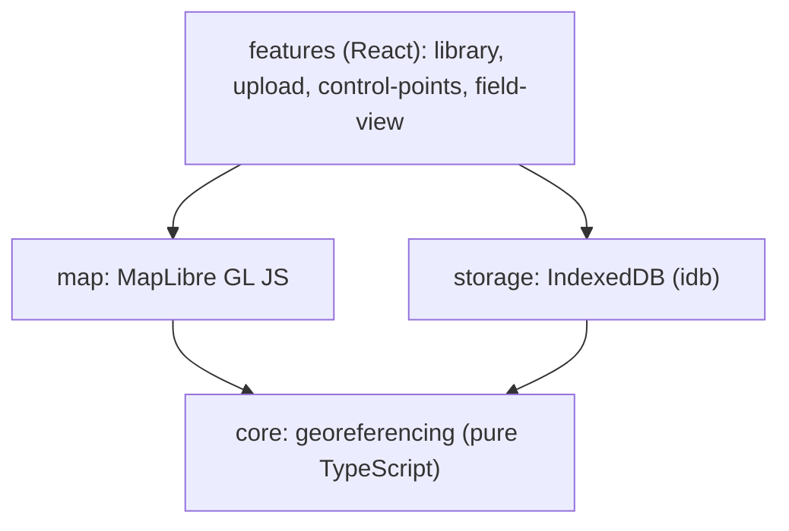

# map-boundary-overlay

[](https://github.com/Eng-Ben/map-boundary-overlay/actions/workflows/ci.yml)

A progressive web app that overlays your own map image (a screenshot or scanned map) on Kartverket's topographic map using control points, and shows your GPS position on top. Useful for checking trails and boundaries in the field, such as hunting areas.

> **Approximate placement.** The overlay is an estimate. Always verify boundaries yourself before relying on them.

## Demo

**Live demo:** <https://eng-ben.github.io/map-boundary-overlay/>

The demo currently shows the project skeleton; map features arrive in later milestones. A GIF will be added with v0.1.0. The demo uses a synthetic map, never real third-party map data.

## Features

Planned for v0.1.0:

- Upload a map image (PNG, JPEG, WebP)
- Kartverket topographic base map with attribution
- Mark control points with a crosshair on both the image and the base map
- Overlay with adjustable opacity
- Error estimate in metres (leave-one-out, from 4 points)
- GPS position with accuracy circle
- Local storage of map projects, with full deletion
- Installable PWA

## Architecture

Client-only app with no backend. Dependencies point one way: `features → map / storage → core`.



Georeferencing fits an affine transform with least squares in Web Mercator metres and passes the four image corners to MapLibre. See [docs/architecture.md](docs/architecture.md) and the decisions in [docs/adr/](docs/adr/).

## Tech stack

| Choice                             | Why                                                                |
| ---------------------------------- | ------------------------------------------------------------------ |
| React + Vite + TypeScript (strict) | Fast builds, strong typing, shared setup with other portfolio apps |
| MapLibre GL JS                     | Open-source WebGL map with native image overlays                   |
| IndexedDB via idb                  | Stores large image blobs locally without a server                  |
| vite-plugin-pwa                    | Installable app and offline app shell                              |
| ESLint + Prettier                  | Code quality and consistent formatting                             |
| Vitest                             | Fast unit tests for the georeferencing core                        |
| Playwright                         | End-to-end tests against the production build                      |
| nginx (non-root)                   | Small static image for the home server                             |

## Security

| Measure                                                            | Why                                            |
| ------------------------------------------------------------------ | ---------------------------------------------- |
| No backend, accounts or analytics                                  | Nothing to breach and no tracking              |
| GPS position kept in memory only                                   | Location history is never stored               |
| Map projects stored only in the browser; delete removes everything | Users keep control of their own data           |
| Container runs nginx as a non-root user                            | Limits damage if the web server is compromised |
| CI jobs use least-privilege permissions                            | A compromised step cannot publish or write     |

Who can see what: Kartverket receives tile requests and can see which area is displayed. When self-hosted, IP addresses appear in the reverse proxy (Caddy) and nginx logs, and at Cloudflare if public access is enabled.

## Repository layout

```text
.github/workflows/   CI, GitHub Pages and container image workflows
docs/                Architecture notes and ADRs (docs/adr/)
e2e/                 Playwright end-to-end tests
public/              Static assets (icons, manifest)
src/                 App source (core, map, storage, features, app)
```

## Running

Requires Node 26 (see `.nvmrc`).

```sh
npm ci
npm run dev
```

Production build and preview:

```sh
npm run build
npm run preview
```

Container image (as on the home server; listens on port 8080 without TLS):

```sh
docker run --rm -p 8080:8080 --read-only --tmpfs /tmp \
  --cap-drop ALL --security-opt no-new-privileges \
  ghcr.io/eng-ben/map-boundary-overlay:latest
```

Health check: `GET /healthz` returns 200.

## Testing and evaluation

```sh
npm run lint
npm run typecheck
npm run format:check
npm test
npm run e2e
```

End-to-end tests run in CI on Linux. Current Playwright browsers do not support macOS 13, so `npm run e2e` will not run on that version (see [ADR 004](docs/adr/004-e2e-in-ci-only.md)).

The container image is built and smoke-tested in CI only (`scripts/smoke-test-image.sh`): health check, all referenced files, 404 for missing assets, no-cache on `index.html`, non-root user and memory below 300 MB, with a read-only filesystem and no capabilities.

## Roadmap

- [ ] M0: Project setup, CI, GitHub Pages and container image
- [ ] M1: Topographic base map, attribution and disclaimer
- [ ] M2: Georeferencing core with tests
- [ ] M3: Image upload and control points
- [ ] M4: Overlay and GPS
- [ ] M5: Storage and PWA, tested with both base paths
- [ ] M6: Field test, README and v0.1.0

Known limitations:

- Affine fit only: placement error grows with map size; a warning is shown above about 20 km.
- No offline base map in v0.1.0.
- End-to-end tests cannot run locally on macOS 13.

## Data sources, licenses and attribution

- Code: [MIT](LICENSE).
- Base map: © Kartverket, licensed under CC BY 4.0. Exact attribution text needs verification and will be added with the map in M1.
- Map data from Inatur is never fetched automatically, and Inatur screenshots are not included in this repository.
