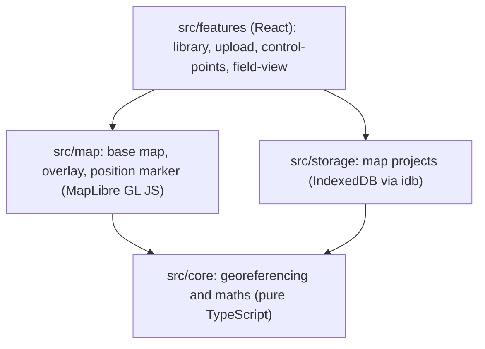
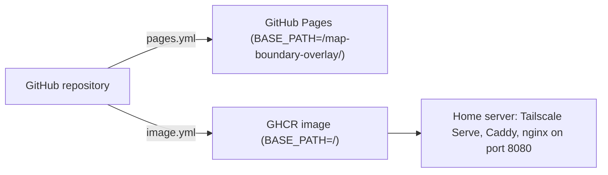

# Architecture

## Overview

map-boundary-overlay is a client-only progressive web app. All processing happens in the browser; there is no backend. The same static build is published to GitHub Pages (public demo) and as a non-root nginx container image for the home server.

## Layers

- `core` has no dependency on the browser or any framework, so it can be unit tested in Node.
- Dependencies only point downwards.

## Georeferencing

- A control point pairs an image pixel with a longitude/latitude.
- Longitude/latitude is converted to Web Mercator metres, and a 6-parameter affine transform is fitted with least squares.
- The four image corners are passed to MapLibre's image source. An affine transform always yields a parallelogram, so MapLibre's experimental warping is avoided.
- The map can be placed from 3 points. Quality is shown from 4 points as leave-one-out error in metres, scaled by cos(latitude).
- Nearly collinear points are detected and rejected.
- Expected model error (needs verification against a projection library): about 2–3 m at 5 km, 7–11 m at 10 km, 27–42 m at 20 km and 170–265 m at 50 km. A warning is shown when the map spans more than about 20 km.

## Data model

`MapProject`: `id`, `name`, `image` (Blob), `imageSize { width, height }`, `controlPoints [{ pixel: [x, y], lngLat: [lng, lat] }]`, `transform` (AffineTransform or null, derived), `opacity`, `createdAt`, `schemaVersion`.

## Deployment

- `BASE_PATH` at build time controls the Vite base, the manifest `start_url` and `scope`, and the service worker scope.
- The container serves one HTTP port (8080) without TLS. TLS is terminated by Tailscale Serve (private) or Cloudflare Tunnel (public).
- `/healthz` returns 200. Unknown paths fall back to `index.html`. `index.html`, `sw.js` and the manifest are not cached.
- Each address (Tailscale, Cloudflare, Pages) has its own browser storage; use one address in the field.
